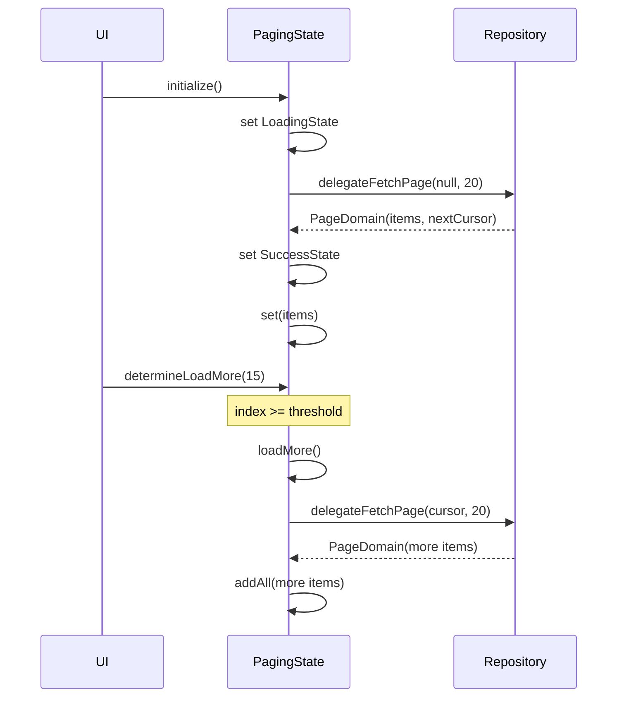

# Complete Guide: StateSignal & PagingStateSignal

A comprehensive guide to state management using `StateSignal` and `PagingStateSignal` in your Flutter application, built on top of the `signals_flutter` package.

---

## Table of Contents

1. [Architecture Overview](#architecture-overview)
2. [StateSignal - Single Data State](#statesignal---single-data-state)
3. [PagingStateSignal - Paginated List State](#pagingstatesignal---paginated-list-state)
4. [Controller Helper Methods](#controller-helper-methods)
5. [UI Consumption Patterns](#ui-consumption-patterns)
6. [Complete Examples](#complete-examples)
7. [Best Practices](#best-practices)
8. [Common Patterns](#common-patterns)

---

## Architecture Overview

### The State Lifecycle

All state management follows a unified lifecycle with 4 states:

```mermaid
stateDiagram-z
    [*] --> InitState
    InitState --> LoadingState: Start fetching
    LoadingState --> SuccessState: Data loaded
    LoadingState --> ErrorState: Fetch failed
    ErrorState --> LoadingState: Retry
    SuccessState --> LoadingState: Refresh
```

### State Types (IState)

```dart
sealed class IState {
  final bool isLoading;
  final bool hasError;
  bool get available => !isLoading && !hasError && (this is! InitState);
  AppError? get error;
}
```

| State | isLoading | hasError | available | Use Case |
|-------|-----------|----------|-----------|----------|
| **InitState** | false | false | false | Before any action |
| **LoadingState** | true | false | false | Data fetching in progress |
| **SuccessState** | false | false | **true** | Data loaded successfully |
| **ErrorState** | false | true | false | Fetch failed |

---

## StateSignal - Single Data State

### Overview

`StateSignal<T>` wraps a single piece of data with lifecycle state tracking. Perfect for:
- Fetching single items/details
- Form submissions
- User profile data
- Any single asynchronous operation

### Basic Usage

#### 1. Define in Controller

```dart
@injectable
class ItemController extends Controller {
  final ItemRepository repository;
  
  ItemController(this.repository);
  
  // Initialize with a dummy/default value
  final state = StateSignal<ItemDomain>(DummyItemDomain());
  
  // Additional state for counters, flags, etc.
  final counterState = StateSignal<int>(0);
}
```

> **💡 Tip**: Use a dummy object or empty value for initialization. The actual data comes from `complete()`.

#### 2. Update State

**Option A: Using `mainStateGuard` (RECOMMENDED)**

```dart
Future<void> initialize() async {
  await mainStateGuard(
    () => repository.getItem(id: id),
    state: state,
    showError: true, // Auto-show error popup
  );
}
```

**How `mainStateGuard` works:**
1. Calls `state.loading()` automatically
2. Executes your async function
3. Calls `state.complete(result)` on success
4. Calls `state.failure(error)` on error
5. Optionally shows error popup

**Option B: Manual State Management**

```dart
Future<void> loadData() async {
  try {
    state.loading();
    final result = await repository.getData();
    state.complete(result); // Updates value AND state
  } catch (e) {
    state.failure(AppError.from(e));
  }
}
```

#### 3. State Methods

```dart
class StateSignal<T> extends Signal<T> with StateSignalMixin<T> {
  // Update state to loading
  void loading();
  
  // Update state to success with new data
  void complete(T data);
  
  // Update state to error
  void failure(AppError error);
  
  // Reset to initial state
  void init();
  
  // State checks
  bool get isLoading;
  bool get hasError;
  bool get available; // true when data is ready
  AppError? get error;
}
```

### Advanced: Parallel Loading

Load multiple things simultaneously and combine results:

```dart
Future<void> initialize() async {
  await mainStateGuard(
    () async {
      final results = await Future.wait([
        repository.getItem(id: id),
        fetchCounter(),
      ]);
      return results.first as ItemDomain;
    },
    state: state,
  );
}

Future<void> fetchCounter() {
  return guard(() async {
    final result = await repository.fetchCounter();
    counterState.value = result;
  });
}
```

### Computed Signals

Create derived state from multiple signals:

```dart
late final snCalculated = computed(() {
  final stateValue = state.value.value;
  final counterValue = counterState.value;
  return stateValue + counterValue;
});

@override
void dispose() {
  snCalculated.dispose(); // IMPORTANT: Dispose computed signals
  counterState.dispose();
  state.dispose();
}
```

---

## PagingStateSignal - Paginated List State

### Overview

`PagingStateSignal<T>` handles paginated lists with automatic loading states, cursor management, and end detection.

### Basic Setup

#### 1. Define in Controller

```dart
@injectable
class ListController extends Controller {
  final ListRepository repository;
  
  ListController(this.repository);
  
  late final pagingState = PagingStateSignal<ItemDomain>(
    limit: 20,        // Items per page
    threshold: 5,     // Load more when 5 items from bottom
    delegateFetchPage: (cursor, limit) {
      return repository.getItems(cursor: cursor, limit: limit);
    },
  );
  
  void initialize() {
    pagingState.initialize();
  }
  
  Future<void> refresh() => pagingState.refresh();
}
```

#### 2. Repository Implementation

Your repository must return `PageDomain<T>`:

```dart
@LazySingleton()
class ListRepository extends Repository {
  final RestClient client;
  
  ListRepository(this.client);
  
  Future<PageDomain<ItemDomain>> getItems({
    String? cursor,
    int limit = 10,
  }) async {
    return resultGuard(() async {
      final response = await client.get('/items', queryParams: {
        'cursor': cursor,
        'limit': limit,
      });
      
      final items = (response['data'] as List)
          .map((json) => ItemDomain.fromJson(json))
          .toList();
      
      return PageDomain(
        elements: items,
        nextCursor: items.isNotEmpty ? items.last.id : null,
        limit: limit,
      );
    });
  }
}
```

### Core Methods

```dart
class PagingStateSignal<T> {
  // Initialize/reset - clears data and fetches first page
  Future<void> initialize();
  
  // Refresh - fetches first page without clearing current data
  Future<void> refresh();
  
  // Load next page
  Future<void> loadMore();
  
  // Auto-trigger loadMore when scrolling near end
  Future<void> determineLoadMore(int index);
  
  // Reset to initial state
  void reset();
  
  // State properties
  bool get isLoadingFirstPage; // Loading AND list is empty
  bool get isErrorFirstPage;   // Error AND list is empty
  bool get hasReachedEnd;      // No more pages
}
```

### State Properties

```dart
// Inherited from StateSignalMixin
pagingState.isLoading;      // Currently fetching
pagingState.hasError;       // Last fetch failed
pagingState.available;      // Has data and not loading/error

// Pagination-specific
pagingState.isLoadingFirstPage;  // Initial load
pagingState.isErrorFirstPage;    // Initial load failed
pagingState.hasReachedEnd;       // No more pages

// Access list data
pagingState.value;          // List<T>
pagingState[index];         // Access item by index
pagingState.length;         // List length
```

### Loading Flow



---

## Controller Helper Methods

### mainStateGuard

For operations that update a **specific StateSignal**:

```dart
Future<void> mainStateGuard<T>(
  Future<T> Function() func, {
  required StateSignal<T> state,
  bool showError = false,
  String Function(AppError)? computeErrorMessage,
})
```

**Example:**
```dart
await mainStateGuard(
  () => repository.getUser(userId),
  state: userState,
  showError: true,
);
```

### guard

For side-effects without a specific state (like mutations):

```dart
Future guard(
  Future Function() func, {
  bool showError = true,
  String Function(AppError)? computeErrorMessage,
})
```

**Example:**
```dart
void incrementCounter() {
  guard(() async {
    final value = counterState.peek();
    if (value >= 5) {
      throw AppError(
        title: 'Limit Reached',
        description: 'Counter must be less than 5',
      );
    }
    counterState.complete(value + 1);
  });
}
```

---

## UI Consumption Patterns

### Pattern 1: StateView (Full-Screen Content)

For main content areas that need loading/error/success states:

```dart
StateView(
  state: controller.state,
  retry: controller.initialize,
  builder: (item) {
    // Only called when data is available (SuccessState)
    return Center(
      child: Text(item.toString()),
    );
  },
)
```

**Features:**
- ✅ Auto-handles loading (shows `AppCircularProgress`)
- ✅ Auto-handles errors (shows `AppErrorWidget` with retry button)
- ✅ Builder only called with non-null data
- ✅ Automatic `Watch` wrapper (rebuilds on state changes)

**Custom Loading/Error:**
```dart
StateView(
  state: controller.state,
  retry: controller.initialize,
  loading: CustomLoadingWidget(),
  errorBuilder: (error) => CustomErrorWidget(error),
  builder: (item) => YourContent(item),
)
```

### Pattern 2: AvailableStateView (Conditional Visibility)

For elements that should only appear when data is ready:

```dart
floatingActionButton: AvailableStateView(
  state: controller.state,
  builder: (item) {
    return FloatingActionButton(
      onPressed: controller.incrementCounter,
      child: const Icon(Icons.add),
    );
  },
)
```

**Use cases:**
- FABs dependent on loaded data
- Action buttons
- Supplementary UI elements

### Pattern 3: Manual Watch

For custom state handling:

```dart
Watch((context) {
  final data = controller.state.value; // MUST read .value
  
  if (controller.state.isLoading) {
    return CircularProgressIndicator();
  }
  
  if (controller.state.hasError) {
    return Text('Error: ${controller.state.error?.title}');
  }
  
  return Text('Data: ${data.name}');
})
```

> **⚠️ CRITICAL**: Always access `.value` inside `Watch` to trigger rebuilds!

### Pattern 4: SliverPaginationView (Paginated Lists)

**RECOMMENDED** way to consume `PagingStateSignal`:

```dart
CustomScrollView(
  slivers: [
    SliverPaginationView(
      pagingState: controller.pagingState,
      padding: EdgeInsets.all(16),
      itemBuilder: (context, index) {
        final item = controller.pagingState[index];
        return ItemWidget(item);
      },
      separatorBuilder: (context, index) {
        return SizedBox(height: 16);
      },
      // Optional customizations
      emptyView: EmptyListWidget(),
      noMoreItemsView: Text('No more items'),
    ),
  ],
)
```

**What it handles automatically:**
- ✅ First page loading state
- ✅ First page error state
- ✅ Empty state
- ✅ Load more triggering via `determineLoadMore`
- ✅ Load more loading indicator
- ✅ Load more error with retry
- ✅ End of list indicator
- ✅ Smooth animations between states

### Pattern 5: Pull-to-Refresh

Combine with `AppScrollView` for pull-to-refresh:

```dart
AppScrollView(
  slivers: [
    SliverPaginationView(
      pagingState: controller.pagingState,
      itemBuilder: (context, index) => ItemWidget(
        controller.pagingState[index],
      ),
    ),
  ],
  onRefresh: controller.refresh, // Uses pagingState.refresh()
)
```

---

## Complete Examples

### Example 1: Single Item Detail Page

**Controller:**
```dart
@injectable
class ItemController extends Controller {
  final String id;
  final ItemRepository repository;

  ItemController(
    @factoryParam this.id,
    this.repository,
  );

  final state = StateSignal<ItemDomain>(DummyItemDomain());
  final counterState = StateSignal<int>(0);
  
  late final snCalculated = computed(() {
    final stateValue = state.value.value;
    final counterValue = counterState.value;
    return stateValue + counterValue;
  });

  Future<void> initialize() async {
    await mainStateGuard(
      () async {
        final results = await Future.wait([
          repository.getItem(id: id),
          fetchCounter(),
        ]);
        return results.first as ItemDomain;
      },
      state: state,
    );
  }

  Future<void> fetchCounter() {
    return guard(() async {
      final result = await repository.fetchCounter();
      counterState.value = result;
    });
  }

  void incrementCounter() {
    guard(() async {
      final value = counterState.peek();
      if (value >= 5) {
        throw AppError(
          title: 'This is title',
          description: 'Counter must be less than 5',
        );
      }
      counterState.complete(value + 1);
    });
  }

  void dispose() {
    snCalculated.dispose();
    counterState.dispose();
    state.dispose();
  }
}
```

**Page:**
```dart
@RoutePage()
class ItemPage extends StatefulWidget {
  final String id;
  const ItemPage({super.key, @PathParam('id') required this.id});

  @override
  State<ItemPage> createState() => _ItemPageState();
}

class _ItemPageState extends State<ItemPage> {
  late final controller = getIt<ItemController>(param1: widget.id);

  @override
  void initState() {
    super.initState();
    controller.initialize();
  }

  @override
  Widget build(BuildContext context) {
    return Scaffold(
      appBar: AppBar(title: Text('Item Page')),
      
      // FAB only shows when item is loaded
      floatingActionButton: AvailableStateView(
        state: controller.state,
        builder: (item) {
          return FloatingActionButton(
            onPressed: controller.incrementCounter,
            child: const Icon(Icons.add),
          );
        },
      ),
      
      // Main content with loading/error handling
      body: StateView(
        state: controller.state,
        retry: controller.initialize,
        builder: (item) {
          return Center(
            child: Column(
              mainAxisAlignment: MainAxisAlignment.center,
              children: [
                Text(item.toString()),
                
                // Counter state (separate Watch)
                Watch((context) {
                  return Text('Counter: ${controller.counterState.value}');
                }),
                
                // Computed signal
                Watch((context) {
                  return Text('Calculated: ${controller.snCalculated.value}');
                }),
              ],
            ),
          );
        },
      ),
    );
  }

  @override
  void dispose() {
    controller.dispose();
    super.dispose();
  }
}
```

### Example 2: Paginated List Page

**Controller:**
```dart
@injectable
class ListController extends Controller {
  final ListRepository repository;

  ListController(this.repository);

  late final pagingState = PagingStateSignal<ItemDomain>(
    limit: 20,
    threshold: 5,
    delegateFetchPage: (cursor, limit) {
      return repository.getItems(cursor: cursor, limit: limit);
    },
  );

  void initialize() {
    pagingState.initialize();
  }

  Future<void> refresh() async {
    return pagingState.refresh();
  }
}
```

**Page:**
```dart
@RoutePage()
class ListPage extends StatefulWidget {
  const ListPage({super.key});

  @override
  State<ListPage> createState() => _ListPageState();
}

class _ListPageState extends State<ListPage> {
  final controller = getIt<ListController>();

  @override
  void initState() {
    super.initState();
    controller.initialize();
  }

  @override
  Widget build(BuildContext context) {
    return Scaffold(
      appBar: AppBar(title: Text('List Page')),
      body: AppScrollView(
        slivers: [
          SliverPaginationView(
            pagingState: controller.pagingState,
            padding: const EdgeInsets.symmetric(vertical: 16, horizontal: 24),
            itemBuilder: (context, index) {
              final item = controller.pagingState[index];
              return Container(
                key: ValueKey(item.id),
                height: 100,
                color: Colors.grey.shade200,
                child: Center(
                  child: Text(
                    item.value,
                    style: context.typo.heading20.bold,
                  ),
                ),
              );
            },
            separatorBuilder: (context, index) {
              return const SizedBox(height: 16);
            },
          ),
        ],
        onRefresh: controller.refresh,
      ),
    );
  }
}
```

---

## Best Practices

### ✅ DO

1. **Initialize with dummy values**
   ```dart
   final state = StateSignal<User>(EmptyUser()); // Not null
   ```

2. **Use `mainStateGuard` for state updates**
   ```dart
   await mainStateGuard(() => repository.fetch(), state: state);
   ```

3. **Always read `.value` inside Watch**
   ```dart
   Watch((context) {
     final data = state.value; // Triggers rebuild
     return Text(data.name);
   });
   ```

4. **Dispose computed signals**
   ```dart
   @override
   void dispose() {
     computedSignal.dispose();
     state.dispose();
   }
   ```

5. **Use `SliverPaginationView` for lists**
   - Handles all edge cases
   - Automatic load more
   - Better UX

6. **Use `peek()` when you don't want to trigger rebuilds**
   ```dart
   final currentValue = state.peek(); // Read without subscribing
   ```

### ❌ DON'T

1. **Don't forget to read `.value` in Watch**
   ```dart
   // ❌ BAD - Won't rebuild
   Watch((context) {
     if (state.isLoading) return Loading();
     return Text('Done');
   });
   
   // ✅ GOOD
   Watch((context) {
     final _ = state.value; // Force tracking
     if (state.isLoading) return Loading();
     return Text('Done');
   });
   ```

2. **Don't use nullable initial values**
   ```dart
   // ❌ BAD
   final state = StateSignal<User?>(null);
   
   // ✅ GOOD
   final state = StateSignal<User>(EmptyUser());
   ```

3. **Don't manually manage pagination state**
   - Use `PagingStateSignal` instead of manual list management

4. **Don't forget error handling**
   ```dart
   // Always wrap in guard/mainStateGuard
   ```

---

## Common Patterns

### Pattern: Multiple StateSignals in One Controller

```dart
class ProfileController extends Controller {
  final state = StateSignal<User>(EmptyUser());
  final postsState = StateSignal<List<Post>>([]);
  final settingsState = StateSignal<Settings>(DefaultSettings());
  
  Future<void> initialize() async {
    await Future.wait([
      mainStateGuard(() => repo.getUser(), state: state),
      mainStateGuard(() => repo.getPosts(), state: postsState),
      mainStateGuard(() => repo.getSettings(), state: settingsState),
    ]);
  }
}
```

### Pattern: Optimistic Updates

```dart
void likePost(String postId) {
  final currentPost = state.peek();
  
  // Optimistically update UI
  state.complete(currentPost.copyWith(liked: true));
  
  // Send to server
  guard(() async {
    await repository.likePost(postId);
  }, showError: true).catchError((_) {
    // Revert on error
    state.complete(currentPost);
  });
}
```

### Pattern: Debounced Search with PagingStateSignal

```dart
class SearchController extends Controller {
  final searchQuery = Signal('');
  Timer? _debounce;
  
  late final pagingState = PagingStateSignal<SearchResult>(
    limit: 20,
    threshold: 5,
    delegateFetchPage: (cursor, limit) {
      return repository.search(
        query: searchQuery.value,
        cursor: cursor,
        limit: limit,
      );
    },
  );
  
  void onSearchChanged(String query) {
    searchQuery.value = query;
    _debounce?.cancel();
    _debounce = Timer(Duration(milliseconds: 500), () {
      pagingState.initialize(); // New search
    });
  }
}
```

### Pattern: Conditional Loading

```dart
Future<void> loadIfNeeded() async {
  if (state.available) return; // Already loaded
  await initialize();
}
```

---

## Troubleshooting

### Issue: Widget not rebuilding

**Cause:** Not reading `.value` inside `Watch`

**Solution:**
```dart
Watch((context) {
  final _ = state.value; // Add this
  if (state.isLoading) return Loading();
  return Content();
});
```

### Issue: Pagination not auto-loading

**Cause:** Not using `SliverPaginationView` or not calling `determineLoadMore`

**Solution:** Use `SliverPaginationView` which handles it automatically.

### Issue: Memory leaks

**Cause:** Not disposing computed signals

**Solution:**
```dart
@override
void dispose() {
  computedSignal.dispose();
  state.dispose();
  super.dispose();
}
```

---

## Summary Checklist

### For StateSignal

- [ ] Initialize with non-null dummy value
- [ ] Use `mainStateGuard` for updates
- [ ] Consume with `StateView` or `AvailableStateView`
- [ ] Always read `.value` in manual `Watch`
- [ ] Dispose computed signals
- [ ] Handle errors with `showError` or custom error UI

### For PagingStateSignal

- [ ] Define `delegateFetchPage` correctly
- [ ] Return `PageDomain<T>` from repository
- [ ] Use `SliverPaginationView` in UI
- [ ] Call `initialize()` in `initState`
- [ ] Use `refresh()` for pull-to-refresh
- [ ] Set appropriate `limit` and `threshold`

---

**Happy coding with StateSignal! 🚀**
